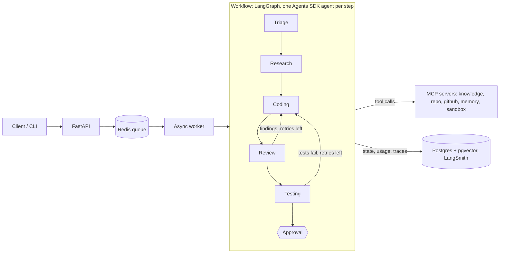
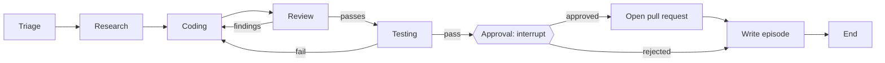

# Architecture

Target design for the full system. Phase status is tracked in the [README](../README.md#roadmap).

## The idea in one paragraph

A GitHub issue goes in; a reviewed, tested pull request comes out, after a human approves it.
Each framework does one job: **LangGraph** owns the workflow (state, checkpoints, retries,
approval pauses), **OpenAI Agents SDK** agents do the open-ended work inside each step, and
**LangChain** handles data and model plumbing (loaders, embeddings, model routing). Every
external action goes through an **MCP server**, which is the enforced permission boundary.

## Workflow

- The graph, not the model, decides what runs next. Retry loops share one bounded counter;
  hitting the limit ends the task as `needs_human`.
- Every node checkpoints to Postgres, so a crashed worker resumes at the last completed step.
- Nodes are idempotent; the pull request is opened at most once per `diff_sha256`.

## Agents

| Agent | Job | Tools (via MCP) | Output |
| --- | --- | --- | --- |
| Triage | Plan the work, judge failures | `github.get_issue`, `knowledge.search` | `Plan` |
| Research | Gather code, docs, past fixes | `repo.read_file`, `repo.search_code`, `knowledge.search` | `ResearchReport` |
| Coding | Edit code in the task's workspace | `repo.read_file`, `repo.write_file`, `repo.diff` | `CodeChange` |
| Review | Find bugs and security issues (read-only) | `repo.read_file`, `repo.diff` | `ReviewResult` |
| Testing | Write tests, run them in the sandbox | `repo.write_file` (tests/ only), `sandbox.run_tests` | `TestReport` |

Between steps the graph owns transitions (no SDK handoffs); inside a step an agent may call
another agent *as a tool*. All hand-overs are Pydantic models (`src/engassist/contracts.py`).

## Security model

Assume the model will eventually do the wrong thing, or be tricked into it; enforce controls in
code and infrastructure, never only in prompts.

| Threat | Control |
| --- | --- |
| Model-written code does harm when run | Sandbox container per run: no network, CPU/memory/time limits, read-only root, non-root |
| Prompt injection via issues, files, docs | Untrusted text wrapped as data; permissions enforced outside the model; writes need approval |
| Over-broad credentials | Fine-grained GitHub token for one repo; per-agent tool allowlists; per-service DB roles |
| Approving one change, shipping another | Approval bound to the diff's SHA-256 |
| Secrets leaking | Never in model context or the sandbox; logs redacted |
| Runaway loops and cost | Retry limits, per-task token/dollar budget, timeouts everywhere |

Every tool call is written to an append-only audit log (task, agent, tool, redacted args, status,
approver).

## Memory

| Layer | Holds | Store |
| --- | --- | --- |
| Working | Current task state | LangGraph checkpoints (Postgres) |
| Short-term | An agent's turns within one step | Agents SDK session |
| Episodic | Summaries of finished tasks and lessons | Postgres + pgvector |
| Semantic | Docs, notes, repo docs | Hybrid-search index from the companion `obsidian-rag` project |

## Evaluation

The headline metric is objective: **do the hidden tests pass on the final diff?** Also tracked:
tool-call correctness (rule checks on trajectories), steps/tokens per task, recovery from injected
faults, review quality (LLM judge calibrated against hand labels), cost and p50/p95 latency, and a
single-agent baseline the multi-agent design must beat.

## Key decisions

| Decision | Chosen | Why |
| --- | --- | --- |
| Who controls the flow | LangGraph | Known pipeline shape; must survive crashes and pause for approval |
| Agent runtime | OpenAI Agents SDK | Small primitives, typed outputs, tool approvals, MCP, tracing |
| LangChain's role | Data and model plumbing only | Avoid two agent frameworks doing one job |
| External access | MCP servers only | One enforced, reusable permission boundary |
| GitHub writes | Human approval bound to diff hash | No unapproved or swapped writes |
